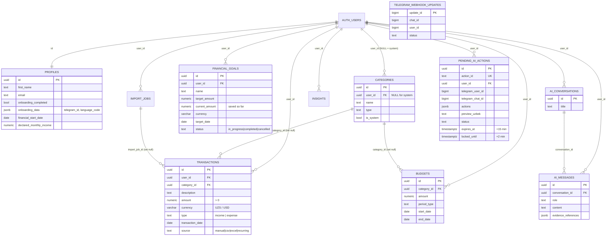
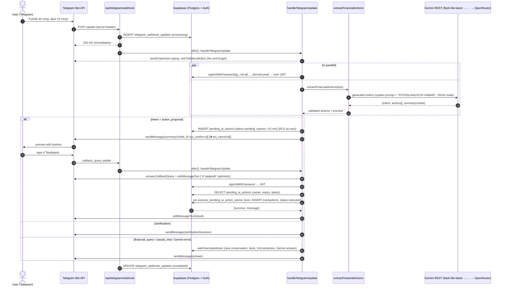

# UzHamyon — How the Project Works (LOGIC.md)

> Written from reading the code on branch `main` at commit `116ff85` (2026-11-18).
> Nothing here is guessed from file names: every statement points to the file that does it.
> Where the code is unclear or could behave two ways, it is listed under **Open questions** (section 8).

---

## 1. Overview

| Topic | What the code does |
|---|---|
| Language | TypeScript (strict), some `.mjs` scripts and tests. `package.json` has `"type": "module"`. |
| Main framework | **Next.js 16.4.2** (App Router, React 19.3, Turbopack, `cacheComponents: true`). Middleware lives in `src/proxy.ts` (Next 16 name for middleware). |
| UI | One big client component, `src/components/prototype/UzHamyonPrototypeApp.tsx` (~3 600 lines), rendered by `/dashboard`, `/transactions`, `/budgets`, `/goals`, `/analytics`. It runs as a **Telegram Mini App** (WebApp) and as a normal website. Tailwind 4. |
| Telegram bot library | **None.** The bot calls the Telegram Bot API directly with `fetch` (`src/lib/telegram/bot.ts`): `sendMessage`, `editMessageText`, `answerCallbackQuery`, `sendChatAction`, `setChatMenuButton`, `getUpdates`. |
| AI | **Google Gemini REST API** (`v1beta/models/{model}:generateContent`) called with `fetch` — **no Gemini SDK is installed**. OpenRouter is a fallback. See section 5. |
| Database | **Supabase** (PostgreSQL + Supabase Auth + Row Level Security). Client: `@supabase/supabase-js` 2.x and `@supabase/ssr`. Schema in `supabase/migrations/`. |
| Validation | `zod` 4 schemas in `src/lib/*/schemas.ts`. |
| How the bot receives updates | **Production: webhook** — `POST /api/telegram/webhook` (`src/app/api/telegram/webhook/route.ts`). It answers `200` at once and processes the update in the background with Next's `after()`. **Development: long polling** — `npm run telegram:bot` runs `server/telegramBot.ts` → `runTelegramPolling()` (`getUpdates`, 20 s timeout). The code never calls `setWebhook`; the webhook URL must have been registered by hand. |
| Deployment | **Vercel** (`vercel.json` cron, `after()`, `maxDuration = 30` on the webhook and AI advisor routes). One cron: `GET /api/telegram/reminders?trigger=true` at `0 15 * * *` UTC = 20:00 Tashkent. |
| Second (older) stack | `vite.config.ts` + `src/main.tsx`/`src/App.tsx` + `server/server.ts` (Hono API on port 3001) + a committed `dist/` build with `_redirects`. It re-uses the same `src/lib` services. Scripts: `dev:vite`, `dev:api`, `build:vite`. It looks unused in production (see Open questions). |

### Environment variables (names only)

Required for the bot + app in production:

| Name | Used for |
|---|---|
| `NEXT_PUBLIC_SUPABASE_URL` | Supabase project URL (hard-coded fallback only outside production). |
| `NEXT_PUBLIC_SUPABASE_ANON_KEY` | Supabase public key (hard-coded fallback only outside production). |
| `SUPABASE_SERVICE_ROLE_KEY` | Admin DB access (Telegram user creation, reminders, webhook idempotency, hydration fallback). Also part of the salt for derived Telegram passwords. |
| `TELEGRAM_BOT_TOKEN` | Every Bot API call; Mini App `initData` signature check; part of derived Telegram passwords. |
| `TELEGRAM_MINIAPP_URL` | URL opened by the "UzHamyon" menu button and inline buttons (fallback `https://uzhamyon.vercel.app/`). |
| `TELEGRAM_WEBHOOK_SECRET` | **Required in production** (webhook rejects every update without it). Header `x-telegram-bot-api-secret-token`. Registered with `npm run telegram:set-webhook`. |
| `INTERNAL_AUTH_SECRET` | HMAC key for the `x-internal-auth` header the middleware passes to server components. **Required in production** (no fallback; without it the proxy skips the header and logs an error). |
| `GEMINI_API_KEY` | Gemini REST calls. |

Optional:

| Name | Used for |
|---|---|
| `GEMINI_MODEL` | Primary Gemini model (default `gemini-3.8-flash`). |
| `GEMINI_FALLBACK_MODEL` | Fallback model (default `gemini-3.7-flash`). |
| `OPENROUTER_API_KEY` / `AI_API_KEY` | OpenRouter fallback when every Gemini model fails. |
| `OPENROUTER_MODEL` | OpenRouter model for the advisor fallback (default `google/gemini-2.5-flash`). |
| `CRON_SECRET` | **Required in production.** Bearer secret for every request to the reminders route (Vercel Cron sends it automatically). |
| `NEXT_PUBLIC_TELEGRAM_BOT_USERNAME`, `TELEGRAM_BOT_USERNAME` | Bot username for the login page. |
| `NODE_ENV` | `production` disables in-memory fallbacks for pending actions. |
| `BASE_URL`, `TEST_BASE_URL`, `TEST_PORT`, `API_PORT`, `TARGET_USER_EMAIL`, `VITE_*` | Tests, scripts and the Vite stack only. |

---

## 2. File map

```
src/
  app/
    api/telegram/webhook/route.ts   Telegram webhook entry (secret check → idempotency claim → after(handleTelegramUpdate))
    api/telegram/reminders/route.ts Daily 20:00 reminder broadcast (Vercel cron) + an unauthenticated status view
    api/auth/telegram/route.ts      Mini App login: verifies initData, creates/signs in user, sets cookies
    api/transactions/…              CRUD for transactions (→ lib/transactions/service.ts)
    api/categories/…                CRUD for categories
    api/goals/…                     CRUD for goals + POST /api/goals/:id/contributions
    api/budgets/…                   CRUD for budgets
    api/analytics/route.ts          Analytics summary (→ lib/analytics/service.ts)
    api/ai/advisor/route.ts         AI chat for the web app (→ lib/ai/advisorService.ts)
    api/ai/conversations, insights  Chat history and AI insight cards
    api/imports/…                   CSV/XLSX import (preview → commit)
    api/timeline/available-months   Months that have transactions
    dashboard|transactions|goals|budgets|analytics/page.tsx  All render UzHamyonPrototypeApp with SSR data
    onboarding/, settings/, (auth)/login, register           Onboarding wizard, profile, email login
  proxy.ts                          Next 16 middleware: strips spoofed headers, refreshes session, signs x-internal-auth
  components/prototype/UzHamyonPrototypeApp.tsx   The real UI (dashboard, add-transaction sheet, goals, budgets, analytics)
  components/…                      Older/secondary components (GoalsManager, ContributeModal, FinanceCard, AIAdvisorChat, …)
  lib/
    telegram/bot.ts                 ALL bot logic: Bot API helpers, handleTelegramUpdate(), polling runner
    telegram/auth.ts                initData verification; getOrCreateTelegramUser() (derived email/password → Supabase session)
    telegram/reminders.ts           Recipient list + reminder text + broadcast loop
    telegram/webhookIdempotency.ts  Claim/complete/fail rows in telegram_webhook_updates (memory fallback)
    ai/geminiClient.ts              Gemini REST client: model fallback list, retries, JSON mode, OpenRouter fallback
    ai/aiClient.ts                  Free-text AI client (Gemini → OpenRouter → fixed text) used by the advisor
    ai/actionExtractionEngine.ts    Text → Gemini JSON → validated list of actions + Uzbek preview (THE AI transaction parser)
    ai/pendingActionStore.ts        pending_ai_actions table: save/get/claim/cancel; "ha"/"bekor" word matchers
    ai/actionExecutor.ts            Runs a confirmed pending action (RPC first, app-level fallback with rollback)
    ai/advisorService.ts            AI financial Q&A with grounded facts; also re-runs intent/extraction (see §4.9)
    ai/financialActionEngine.ts     Older regex-based intent engine (5 scenarios) used inside the advisor
    ai/insightsService.ts           Generates AI insight cards
    transactions/service.ts, schemas.ts, dateTime.ts
    categories/service.ts, predictCategory.ts   (keyword → Uzbek category name; name → DB category matcher)
    goals/service.ts, schemas.ts    Goals (= maqsad and jamg'arma), progress & feasibility
    budgets/, analytics/, imports/, timeline/, onboarding/
    supabase/server.ts, client.ts, config.ts, proxy.ts
    auth/internalAuth.ts            HMAC-signed internal identity header
    data/hydration.ts               SSR data for the dashboard (300 latest tx, budgets, goals)
  types/database.ts                 TypeScript row types
server/
  telegramBot.ts                    Local polling runner (loads .env.local)
  server.ts                         Hono API for the Vite stack
scripts/                            Reminder sender/scheduler, demo seeding, imports, screenshots, AI test scripts
supabase/migrations/                001–006 = old teacher/student app tables; 007–011 = UzHamyon finance schema
tests/                              node:test suites; `npm test` (unit-ish) and `npm run test:integration` (live Supabase)
dist/                               Committed Vite build (older stack)
docs/                               This file + older docs
```

---

## 3. Data model

All finance tables live in `public` and have RLS "owner only" (`auth.uid() = user_id`), an `updated_at` trigger, and a trigger that forbids changing `user_id`.

### Tables

**`auth.users`** (Supabase). Telegram users get email `tg_<telegramId>@telegram.uzhamyon.uz` and a derived password (§4.1).

**`profiles`** (001 + 008 + 009)
`id` (PK, FK → auth.users), `first_name`, `last_name`, `email`, `role` (enum `user_role` from the old app; Telegram users get `'teacher'`), `teacher_id` (old app), `is_active`, `declared_monthly_income`, `declared_monthly_expenses`, `target_expense_reduction_percent`, `target_monthly_expenses`, `onboarding_completed`, `onboarding_step`, `onboarding_data` JSONB (holds `telegram_id`, `telegram_username`, `language_code`, `is_telegram`, onboarding answers), `financial_start_date` DATE, timestamps.

**`categories`** (007)
`id`, `user_id` (NULL for system rows), `name`, `type` (`income|expense`), `description`, `icon`, `color`, `is_system`. Unique on `(lower(trim(name)), type)` per owner. 16 **English** system categories are seeded (e.g. `Groceries`, `Dining Out`, `Transportation`, `Salary`, …).

**`transactions`** (007)
`id`, `user_id`, `category_id` (FK, `ON DELETE SET NULL`), `description` (≤255), `amount` NUMERIC(12,2) **> 0** (direction is in `type`), `currency` VARCHAR(3) (DB default `'USD'`, app default `'UZS'`), `type` (`income|expense`), `transaction_date` DATE, `merchant`, `notes`, `source` (`manual|csv|excel|recurring`), `import_job_id`, `created_at`, `updated_at`. A trigger checks the category/import job belongs to the same user.

**`import_jobs`** (007) — `filename`, `status`, row counters, `error_summary`.

**`budgets`** (007) — `category_id` (nullable = all expenses), `name`, `amount`, `currency`, `period_type` (`monthly|weekly|custom`), `start_date`, `end_date`.

**`financial_goals`** (007) — this is both **maqsad** and **jamg'arma**:
`id`, `user_id`, `name`, `target_amount` (> 0), `current_amount` (≥ 0, the money saved so far), `currency` (DB default `'USD'`, app default `'UZS'`), `target_date` (nullable), `tracking_strategy` (`manual|category_linked|account_linked`, only `manual` is used), `status` (`in_progress|completed|cancelled`).
There is **no contributions table**: only the running total `current_amount` is stored.

**`insights`** (007) — AI insight cards: `type`, `title`, `explanation`, `status`, `confidence`, `evidence_metadata`, `period_start/end`.

**`ai_conversations`**, **`ai_messages`** (007) — chat history; `ai_messages.evidence_references` JSONB also stores the old engine's `pending_action`.

**`pending_ai_actions`** (011) — AI proposals waiting for confirmation:
`id`, `action_id` TEXT UNIQUE (`act_<ms>_<rand6>`), `user_id`, `telegram_user_id`, `telegram_chat_id`, `intent`, `actions` JSONB (array of `ExtractedActionItem`), `preview_uzbek`, `status` (`pending|executing|executed|cancelled|expired|failed`), `result_message`, `error_details`, `retry_count`, `execution_token`, `execution_started_at`, `locked_until`, `completed_at`, `created_at`, `updated_at`, `expires_at` (created + 15 min).
Also defines RPC `execute_pending_ai_action_atomic(p_action_id, p_user_id, p_telegram_user_id)` (SECURITY DEFINER).

**`telegram_webhook_updates`** (010) — `update_id` PK, `chat_id`, `user_id` (Telegram id), `status` (`processing|completed|failed`), `error_message`. Service-role only.

**Old tables from another app** (001–006): `task_templates`, `task_attachments`, `assignments`, `assignment_attachments`, `submissions`, `submission_attachments`, `reading_tests`, `reading_test_assignments`, `reading_test_submissions`, plus storage buckets. Not used by UzHamyon code.

### ER diagram



---

## 4. Features

### 4.0 How every Telegram update is handled

1. Telegram → `POST /api/telegram/webhook`.
2. Header `x-telegram-bot-api-secret-token` must match `TELEGRAM_WEBHOOK_SECRET`, else `401`. In production a missing secret also means `401` (`src/lib/telegram/requestAuth.ts`).
3. `claimWebhookUpdate(update_id)` inserts a `processing` row in `telegram_webhook_updates`. Duplicate → reply `200 {skipped}`. Stale `processing` rows (> 60 s) and `failed` rows can be re-claimed. If the table is missing it uses an in-memory map.
4. Reply `200` immediately; inside `after()` run `handleTelegramUpdate(update)` then mark `completed` (or `failed` with the error).
5. `handleTelegramUpdate` (`src/lib/telegram/bot.ts:320`) handles **only** `callback_query` and `message.text`. Voice, photo, sticker, edited messages etc. are silently ignored.
6. For every text message it first fires (not awaited) `sendChatAction('typing')` and `setChatMenuButton(chat_id)` (the "UzHamyon" Mini App button on the left of the input).

### 4.1 Identity: Telegram user → Supabase user

`getTelegramUserSupabaseClient(from)` → `getOrCreateTelegramUser()` (`src/lib/telegram/auth.ts`):

- email = `tg_<telegramId>@telegram.uzhamyon.uz`
- password = `HMAC_SHA256(key = "<SERVICE_ROLE_KEY>:<BOT_TOKEN>", "tg_user_auth_identity_<telegramId>")` (hex)
- `signInWithPassword`; if it fails and the user exists → admin resets the password and signs in again; if the user does not exist → `signUp` and insert a `profiles` row (`onboarding_completed=false`, `financial_start_date=today`, `onboarding_data.telegram_id`, `language_code`).
- Returns a user **JWT**; the bot builds an anon-key client with `Authorization: Bearer <jwt>`, so **all bot DB writes go through RLS as that user**.

This runs on **every** incoming message and on every button press.

The Mini App uses the same function via `POST /api/auth/telegram` after verifying `initData` (HMAC with `WebAppData`, max age 24 h), then writes Supabase cookies (`SameSite=None; Secure`) and an extra `sb-access-token` cookie.

### 4.2 Commands

| Trigger | Handler | DB | Reply |
|---|---|---|---|
| `/start` (any text starting with it) | `bot.ts:424` | `isReturningTelegramUser()` reads `profiles` with the service key (`email = tg_…` OR `onboarding_data->>telegram_id`) | Returning + onboarded: "Qaytganingizdan xursandmiz…" + button **Ilovani ochish**. New: long welcome text + button **UzHamyon'ni ochish**. Buttons are `web_app` buttons to `MINIAPP_URL`. |
| `/app` | `bot.ts:438` | none | "UzHamyon ilovasini ochish uchun…" + Mini App button |
| `/help` | `bot.ts:445` | none | Command list + 4 natural-language examples + button |
| `/about` | `bot.ts:452` | none | About text + button |

There is no `setMyCommands`; the command menu (if any) was set by hand in BotFather. There are no reply keyboards, no menus, and no conversation states (no FSM). The only "state" is the `pending_ai_actions` row.

### 4.3 Daromad / xarajat (income / expense)

#### Manual flow (Mini App only — the bot has no manual buttons)

Trigger: user taps "+" in `UzHamyonPrototypeApp`, picks type (`in`/`ex`), amount, Uzbek category name (e.g. `Oziq-ovqat`), description, date, time.
Handler: `handleSaveTransaction` (`UzHamyonPrototypeApp.tsx` ~line 1040):
1. Optimistic UI update.
2. `matchPredictedToDbCategory(cat, categoriesOfThatType)` maps the Uzbek name to a DB category (direct/substring match, then an Uzbek→English alias map, else **the first category in the list**).
3. `POST /api/transactions` (or `PUT /api/transactions/:id`) with `{description, amount, type, currency: 'UZS', transaction_date, transaction_time, category_id}` and `Authorization: Bearer <token>`.
4. `createTransaction()` (`src/lib/transactions/service.ts:36`): zod validation (amount > 0, ≤ 2 decimals, valid date), category must be system or own and same type, insert with `source='manual'`; if a time is given, `created_at = "<date>T<time>:00Z"`; moves `profiles.financial_start_date` earlier if needed.
Reply: toast in the app.

Delete: `DELETE /api/transactions/:id`.

#### AI flow (Telegram text) — summary (full detail in section 5)

Trigger: any non-command text that is not a short "ha"/"bekor".
`extractFinancialActions(text)` (Gemini) **in parallel with** `getTelegramUserSupabaseClient(from)` → if `intent = action_proposal` → save a `pending_ai_actions` row → send `summaryUzbek` with buttons **✅ Tasdiqlash** (`act_confirm:<id>`) / **❌ Bekor qilish** (`act_cancel:<id>`) → on confirm run `executePendingActionRecord()` → insert into `transactions` (and/or goals) → edit the message to the result.

Also: typing a confirmation word (`ha`, `tasdiqlayman`, `saqla`, `mayli`, `yes`, …) confirms the **latest** pending action of this Telegram user; a cancel word (`yo'q`, `bekor`, `rad`, `kerak emas`, `no`, …) cancels it (`isUserConfirmation` / `isUserCancellation` in `pendingActionStore.ts`).

### 4.4 Categories

- System categories: 16 English rows seeded by migration 007. Users can add their own (`/api/categories`, `createCategory`); unique per user by lower-cased name + type. System categories cannot be edited/deleted (RLS + service). A category's type cannot change while transactions use it.
- The UI shows **Uzbek** names (`Oziq-ovqat`, `Kafeler va Restoranlar`, `Transport`, `Uy-joy`, `Kommunal`, `Aloqa va Internet`, `Ko'ngilochar`, `Xaridlar`, `Salomatlik`, `Ta'lim`, `Shaxsiy parvarish`, `Maosh`, `Frilans`, `Investitsiyalar`, `Sovg'alar`). `predictCategoryFromTitle()` guesses one from the description with a keyword list (Uzbek Latin, Russian, English); default `Oziq-ovqat` / `Maosh`.
- Mapping Uzbek name → DB row: `matchPredictedToDbCategory()` (see 4.3).
- AI flow: Gemini returns a free-text `categoryName` (the prompt does **not** give it the category list).
  - RPC path: exact case-insensitive name match against user + system categories, else `NULL`.
  - App-level fallback path: `matchPredictedToDbCategory()` (which falls back to the first category).
- Transactions with no category show as "Boshqa" in the UI and "Uncategorized" in analytics.

### 4.5 Jamg'arma (savings)

There is **no separate savings account or table**. "Jamg'arma" = the sum of `financial_goals.current_amount` across the user's goals.

- **Add money** (web): goal detail → "Hissa qo'shish" → `handleSaveContribution` → optimistic UI → `POST /api/goals/:id/contributions {amount}` → `contributeToGoal()` (`src/lib/goals/service.ts:419`):
  `new = max(0, round2(current + amount))`; `status = new >= target ? 'completed' : 'in_progress'`; update the row.
- **Add money** (AI/Telegram): action `contribute_goal` (e.g. "Noutbuk maqsadiga 500 ming qo'shdim"), see §4.6.
- **Withdraw**: the API accepts a **negative** `amount` (schema only forbids 0), clamped at 0. The current Mini App sheet only sends positive amounts; the older `ContributeModal.tsx` has a "Balansga qaytarish" (withdraw) button but is not used by the live pages. The AI flow cannot withdraw (amount must be > 0).
- **Where stored**: only `financial_goals.current_amount`. Individual contributions (date, note) are **not stored**; the UI rebuilds a fake history `contribs: [{a: current_amount, d: ''}]` after reload.
- **Effect on balance** (commit `b086299`): the Mini App shows
  `currentBalance = Σ income − Σ expense − Σ max(0, goal.current_amount)` over all loaded transactions (all currencies added together).
  Contributions do **not** create transactions, so analytics (net cash flow, savings rate) do not see them.

### 4.6 Maqsad (goals)

**Create**
- Web: `POST /api/goals` → `createGoal()`; zod: `name` 1–100 chars, `target_amount > 0` (≤ 2 decimals), `current_amount ≥ 0` (default 0), `currency` 3 letters (default `UZS`), `target_date` `YYYY-MM-DD` or null, `tracking_strategy` default `manual`, `status` default `in_progress` (forced to `completed` if current ≥ target).
- AI: "Mashina uchun 50 mln maqsad yarat" → `create_goal` with `goalName`, `targetAmount`, optional `targetDate`.

**Update**: `PUT /api/goals/:id` → `updateGoal()`; if `status` is not sent it is recomputed (`current >= target ? completed : in_progress`). AI: `update_goal` changes `target_amount` (and `target_date` if given) of a goal found by name.

**Progress** (`computeGoalProgress`, `goals/service.ts:121`):
- `remaining = max(0, target − current)`
- `percentage_completed = min(100, current / target × 100)` (2 decimals)
- Feasibility (only if not completed and `target_date` is set):
  - `monthsRemaining` = calendar-month difference between today and target date; `0` if the date is past; `1` if it is later this month.
  - `monthlyNeeded = remaining / monthsRemaining`
  - `avgMonthlyNet = (Σ income − Σ expense) / (number of months that have any transaction)`, only transactions in the goal's currency, all time.
  - `feasible` if `avgMonthlyNet ≥ monthlyNeeded`; `challenging` if `avgMonthlyNet > 0` and `monthlyNeeded ≤ 1.5 × avgMonthlyNet`; otherwise `unlikely`. No date → `not_applicable`.
- The Mini App computes its own simpler `pct = min(100, round(saved / target × 100))`.

**When a goal is reached**: `status` becomes `completed` automatically (in `contributeToGoal`, `updateGoal`, `createGoal` and in the RPC). Nothing else happens — **no Telegram message, no celebration, no transfer**. A later withdrawal below the target flips it back to `in_progress`.

**When the deadline passes**: nothing runs. There is no job. On the next read the feasibility becomes `unlikely` with "Belgilangan muddat o'tib ketgan. Yangi muddat belgilash kerak." The status stays `in_progress`.

**Link to jamg'arma**: a goal *is* the savings bucket; its `current_amount` is the jamg'arma for that goal and is subtracted from the displayed balance.

**AI goal matching**:
- RPC path: `contribute_goal` / `update_goal` pick the most recently updated **`in_progress`** goal whose name `LIKE %goalName%` (or any in-progress goal if no name). Contributions to completed goals fail.
- App-level path: `resolveUserGoal()` — exact name, then substring either way, any status; if no name, first `in_progress` goal or the first goal.

### 4.7 Financial analysis / reports

There are three separate calculators:

**A. Mini App dashboard (client-side, what users actually see)** — `UzHamyonPrototypeApp.tsx` ~line 777–960, using all transactions loaded by `fetchAllTransactions()` (pages of 100, max 50 pages = 5 000 rows; the first render uses the 300 rows from SSR hydration):
- Selected month: `monthIncome = Σ income`, `monthExpense = Σ expense` for `YYYY-MM`.
- `currentBalance = lifetime income − lifetime expense − Σ goal savings` (§4.5).
- Expense by category for the month; top category; "AI recommendation" text = `top category share = round(cat / monthExpense × 100)%`.
- Weeks = days 1–7, 8–14, 15–21, 22–28, 29–end (income and expense per chunk).
- Budget card: `pct = round(spent / limit × 100)`; red if over 100 %, amber if ≥ 80 %.
- All amounts are treated as so'm; currency is ignored.

**B. `GET /api/analytics`** → `getAnalyticsSummary()` (`src/lib/analytics/service.ts`). Its UI components (`AnalyticsView`, `TahlilHub`) are **not imported by any live page** (only named in comments), so today this API is used by tests and the Vite stack only:
- Period: `startDate`/`endDate` query params, default = current calendar month (server time); clipped to `profiles.financial_start_date`.
- Currency: one currency only; if not given, the currency of the newest transaction.
- `totalIncome`, `totalExpenses`, `netCashFlow = income − expenses`.
- `savingsRate = min(100, net / income × 100)` if income > 0 and net > 0, else 0.
- `averageTransactionAmount = (income + expenses) / count`.
- Category breakdowns with `% = category / total × 100`.
- Trends by `day` / `week` (Monday start) / `month`.
- Comparison with the previous period of the same length: absolute and % change (`null` % if previous is 0).
- Top 5 largest expenses and incomes.

**C. AI advisor facts** (`gatherUserFinancialContext`, `advisorService.ts:57`) — sent to Gemini as "verified context": lifetime balance `= income − expense` (**does not subtract goal savings**), per-month income/expense/top categories, month-over-month comparison of the two latest months, small expenses ≤ 100 000, budgets, goals with `monthlyNeeded = remaining / months` and feasibility `avgMonthlyNet ≥ monthlyNeeded`, onboarding planning numbers. Currency = currency of the oldest transaction.

**Budgets** (`computeBudgetProgress`): `spent = Σ expense` in the budget currency, date range and category; `percentageUsed = spent / amount × 100`; `on_track` < 80 % ≤ `near_limit` < 100 % ≤ `over_budget`.

### 4.8 Reminders, scheduled jobs, notifications

- **Daily reminder**: Vercel cron `0 15 * * *` UTC (20:00 Tashkent) → `GET /api/telegram/reminders?trigger=true` → `broadcastDailyTransactionReminders()`:
  - Recipients = every `profiles` row whose email is `tg_<id>@…` or whose `onboarding_data.telegram_id` is set (one query, no paging).
  - For each: `setChatMenuButton`, then `sendMessage`: "Salom, **<name>**! 👋 Bugungi o'tkazmalarni ilovaga kiritishni unutmang yoki shunchaki bugungi o'tkazmalaringizni shu chatga yozib qo'ying! ✍️" + button "🚀 UzHamyon'ni ochish". 60 ms pause between users. Blocked users are counted but not marked anywhere.
  - Auth (since 1A): every GET/POST needs `Authorization: Bearer $CRON_SECRET`; in production a missing secret rejects everything. Only outside production with no secret are requests allowed.
- `GET /api/telegram/reminders` **without** `trigger` (authenticated) returns only the schedule and the recipient **count**.
- Local alternatives: `scripts/send_transaction_reminders.mjs` (one-off) and `scripts/schedule_daily_reminders.mjs` (long-running `setTimeout` loop at 20:00 Tashkent).
- No other jobs: nothing expires pending actions in bulk, nothing checks goal deadlines, no budget alerts are pushed to Telegram.

### 4.9 Free questions and chat in Telegram (financial_query / casual_chat)

If Gemini says `financial_query` or `casual_chat` (or the Gemini call **fails**, which also returns `financial_query`), the bot calls `askFinancialAdvisor(text, undefined, userClient)`:
1. Creates a **new** `ai_conversations` row for every Telegram message (no conversation id is kept).
2. Saves the user message in `ai_messages`.
3. Runs `processFinancialIntent()` (old regex engine): "bu oy … sarfladim" → sum of this month's expenses; "oxirgi xarajatni bekor qil" → proposes deleting the last expense; "naqd pul bor" → asks "existing money or income?"; "ishlab topdim" → proposes income; "sarfladim/ishlatdim/sotib oldim" + amount → proposes expense. These proposals live only inside that one-message conversation, so **they cannot be confirmed from Telegram** (§7).
4. Checks the latest pending action for "ha"/"bekor" (without Telegram id).
5. Runs `extractFinancialActions()` **again** (second Gemini call) with the user's financial context; a proposal found here is saved **without** `telegram_user_id` and sent as plain text without buttons.
6. Otherwise asks Gemini (free text, `aiClient.generateAIContent`) with the grounded facts and a long Uzbek system prompt; if AI fails, answers from facts with a fixed template.
The bot sends the answer text, HTML-escaped (casual chat also gets the Mini App button).

### 4.10 Languages, currencies, user settings

- **Language**: Uzbek (Latin) only. All bot texts and AI prompts are Uzbek. `language_code` from Telegram is saved in `onboarding_data` but never used. Russian input is understood only because Gemini understands it and the category keyword list has Russian words.
- **Currency**: default `UZS`. The AI prompt allows `UZS` or `USD`. There is **no conversion** anywhere and no user currency setting. The Mini App always sends `UZS`. Money is formatted as `45 000 so'm`; USD as `… dollar`.
- **Settings** (`/settings`, `ProfileForm`): name, and shows whether the account is linked to Telegram. **Onboarding** (`/onboarding`) stores `declared_monthly_income`, `declared_monthly_expenses`, `target_expense_reduction_percent`, `target_monthly_expenses`, `onboarding_step`, `onboarding_completed`. These are used only as "planning estimates" in the AI advisor context and to tell new vs returning users on `/start`.
- **Time zone**: the server's local time is used for "today" (`getNowLocalDateString`). On Vercel this is UTC, not Tashkent.

### 4.11 Other web-only features (short)

- **Imports** (`/imports`): upload CSV/XLSX → `previewImport` (parse, find duplicates) → `commitImport` (creates `import_jobs`, inserts rows with `source='csv'|'excel'`).
- **AI insights** (`/insights`, `insightsService.ts`): generates insight cards into `insights`.
- **AI advisor chat** (`/advisor`, `POST /api/ai/advisor`): same `askFinancialAdvisor` as §4.9 but with a real conversation id, so multi-turn confirmation works there.
- **Email login/register** (`/login`, `/register`) for non-Telegram users.

---

## 5. The AI transaction flow in full detail

### 5.1 Where the text goes

`handleTelegramUpdate` (`bot.ts:483`):
```ts
const [userAuth, extracted] = await Promise.all([
  getTelegramUserSupabaseClient(from),   // Supabase sign-in (§4.1)
  extractFinancialActions(text),         // Gemini (no user context passed)
]);
```
`extractFinancialActions(userText, userFinancialContextText?)` in `src/lib/ai/actionExtractionEngine.ts:142`:
1. Empty text → `casual_chat`.
2. `sanitizeUserInputForAi()` replaces card numbers → `[KARTA]`, Uzbek phone numbers → `[TELEFON]`, emails → `[EMAIL]`, bearer tokens/API keys → `[TOKEN]`.
3. `todayDate = getNowLocalDateString()`, `currentTime = getNowLocalTimeString()` (server time).
4. Builds the system prompt (5.3) and the user prompt:
   ```
   FOYDALANUVCHI XABARI: "<sanitized text>"
   ```
   (plus `FOYDALANUVCHINING MAVJUD MA'LUMOTLARI:` + context when called from the advisor; the bot passes no context).
5. `generateGeminiJson(fullPrompt, systemPrompt)` (timeout 30 000 ms per HTTP attempt).

### 5.2 Model, SDK and request

- **SDK**: none. Raw REST: `POST https://generativelanguage.googleapis.com/v1beta/models/{model}:generateContent`, header `X-goog-api-key: $GEMINI_API_KEY`.
- **Request body** (`generateGeminiJson`, `geminiClient.ts:258`):
  ```json
  {
    "contents": [{ "role": "user", "parts": [{ "text": "<user prompt>" }] }],
    "system_instruction": { "parts": [{ "text": "<system prompt>" }] },
    "generationConfig": { "responseMimeType": "application/json", "temperature": 0.1 }
  }
  ```
  No `responseSchema` is sent — the schema is only described in the prompt.
- **Which model actually runs** (`callGeminiApi`, `geminiClient.ts:43`). The extraction passes no preferred model, so models are tried in this order:
  1. `gemini-flash-lite-latest`
  2. `gemini-3.5-flash-lite`
  3. `gemini-flash-latest`
  4. `$GEMINI_MODEL` or `gemini-3.8-flash`
  5. `$GEMINI_FALLBACK_MODEL` or `gemini-3.7-flash`
  6. then OpenRouter `google/gemini-2.5-flash` (if `OPENROUTER_API_KEY`/`AI_API_KEY` is set; text parts only, `max_tokens 1500`, `temperature 0.1`).

  So in normal operation the **first model that answers is `gemini-flash-lite-latest`**. The code comment says this is to avoid the free-tier daily quota on `gemini-3.8-flash`.
- Retry rules per model: up to 2 attempts. `404` or `429` → the model is put in a process-wide `disabledModels` set (skipped until the server instance restarts) and the next model is tried. `5xx` → wait 500 ms, retry once, then next model. Other `4xx` → next model. Network error/timeout → wait 500 ms, retry once.
- The text of all `parts` of the first candidate is joined; markdown code fences are stripped; `JSON.parse`. Parse failure throws.

### 5.3 The full prompt (system instruction)

`buildExtractionSystemPrompt(todayDate, currentTime)` — verbatim, with `${…}` filled at run time:

```text
Siz UzHamyon moliyaviy platformasi uchun foydalanuvchi xabarlarini tahlil qiluvchi va strukturaviy amallarni ajratuvchi AI yordamchisiz.
Bugungi sana: ${todayDate}. Hozirgi vaqt: ${currentTime}. Asosiy valyuta: UZS (so'm).

Vazifangiz: Foydalanuvchi xabarini diqqat bilan o'qib, qat'iy JSON formatida quyidagi sxemaga mos javob qaytarish:
{
  "intent": "action_proposal" | "financial_query" | "clarification" | "casual_chat",
  "actions": [
    {
      "actionType": "create_transaction" | "create_goal" | "update_goal" | "contribute_goal",
      "transactionType": "expense" | "income",
      "amount": number,
      "currency": "UZS" | "USD",
      "description": string,
      "categoryName": string,
      "date": "YYYY-MM-DD",
      "time": "HH:mm",
      "goalName": string,
      "targetAmount": number,
      "targetDate": "YYYY-MM-DD"
    }
  ],
  "clarificationQuestion": string | null,
  "summaryUzbek": string
}

QOIDALAR:
1. "action_proposal" qachon qo'yiladi:
   - Foydalanuvchi xarajat qilganini, daromad olganini, maqsad yaratishni, maqsadini o'zgartirishni yoki jamg'armaga pul qo'shganini aytganda.
   - Bitta xabarda bir nechta tranzaksiya bo'lsa (masalan: "Tushlik 45000 va taksi 15000"), "actions" massivida har biri uchun alohida element yarating!
   - 1 mln = 1 000 000, 50 ming / 50k = 50 000, 2.5 mln = 2 500 000.
   - "kecha" desa: kechagi sana (${yesterday computed as new Date(Date.now()-86400000).toISOString() date}), "bugun" desa: ${todayDate}.

2. "create_goal" vs "update_goal" vs "contribute_goal":
   - "Yangi maqsad: Noutbuk uchun 10 mln" -> actionType: "create_goal", goalName: "Noutbuk", targetAmount: 10000000.
   - "Noutbuk maqsadini 12 mln ga o'zgartir" -> actionType: "update_goal", goalName: "Noutbuk", targetAmount: 12000000.
   - "Noutbuk maqsadiga 500 ming qo'shdim" / "hissa qo'shdim" -> actionType: "contribute_goal", goalName: "Noutbuk", amount: 500000.

3. "clarification" qachon qo'yiladi:
   - Foydalanuvchi amal bajarmoqchi, lekin zarur summa aytilmagan (masalan: "Tushlik qildim" yoki "Noutbuk maqsadi yaratmoqchiman").
   - clarificationQuestion maydoniga o'zbek tilida bitta qisqa aniqlashtiruvchi savol yozing.

4. "financial_query" qachon qo'yiladi:
   - Foydalanuvchi o'z balansi, xarajatlari, kategoriyalari yoki budjeti haqida savol berganda (masalan: "Bu oy qancha pul sarfladim?", "Balansim qancha?"). actions: [].

5. "casual_chat" qachon qo'yiladi:
   - Oddiy salomlashuv, tashakkur yoki umumiy suhbat ("Salom", "Rahmat", "Qandaysan"). actions: [].

6. "summaryUzbek":
   - Foydalanuvchiga amallarni tasdiqlash uchun aniq, chiroyli va tushunarli o'zbekcha xulosa (preview).
   - Masalan: "Quyidagi 2 ta xarajatni qayd etishni tasdiqlaysizmi?\n• Tushlik: 45 000 so'm\n• Taksi: 15 000 so'm"
```

### 5.4 Expected response (JSON) and validation

Shape: exactly the schema in the prompt (`RawGeminiOutput`). Validation in `extractFinancialActions` (no zod — manual checks):

| Field | Rule |
|---|---|
| `intent` | Must be one of the 4 values, else `casual_chat`. |
| amount | `rawAmount = Number(amount) \|\| Number(targetAmount) \|\| 0` |
| `currency` | `"USD"` stays USD; anything else → `UZS`. |
| `date` | Kept if a valid calendar date, else today. Future dates are allowed. |
| `time` | Kept as-is if present (not validated), else now. |
| `create_goal` / `update_goal` | Kept only if `targetAmount > 0`. `goalName` default "Jamg'arma maqsadi". `targetDate` kept only if valid. Description generated. |
| `contribute_goal` | Kept only if `amount > 0`. |
| anything else | Treated as `create_transaction`; kept only if `amount > 0`; `transactionType` `income` or else `expense`; description default "Daromad"/"Xarajat"; `categoryName` as given. |
| After loop | If ≥ 1 valid action → `intent = action_proposal`. If Gemini said `action_proposal` but nothing survived → `clarification`. |
| `summaryUzbek` | Gemini's text; if empty, a template is built (single action or numbered list). Final fallback "Iltimos, ma'lumotingizni tasdiqlang." |
| On any exception | Logged; returns `{ intent: 'financial_query', actions: [] }` → bot goes to the advisor (§4.9). |

There is no upper limit on amount (the DB column caps at 9 999 999 999.99) and no limit on the number of actions.

### 5.5 Confirmation step

- **Store**: `savePendingAction()` inserts into `pending_ai_actions` using the **user's** client (RLS insert policy) with `telegram_user_id`, `telegram_chat_id`, `actions`, `preview_uzbek`, `status='pending'`, `expires_at = now + 15 min`. In non-production, a missing table falls back to an in-memory `Map`; in production it refuses ("Tizimda yangilanishlar bajarilmoqda…").
- **Message**: `sendTelegramInlineButtons(chatId, summaryUzbek, [[✅ Tasdiqlash → act_confirm:<id>, ❌ Bekor qilish → act_cancel:<id>]])`, `parse_mode: HTML`.
- **Timeout**: 15 minutes (`ACTION_TTL_MS`), checked when the user acts; nothing deletes or edits old proposals.
- **✅ pressed** (`bot.ts`, since 1A):
  1. `answerCallbackQuery`, then edit the message to the preview + "⏳ Saqlanmoqda..." (this removes the buttons, so no double tap).
  2. Sign in the user; `getPendingAction(id, userId, telegramId)` checks owner (Supabase id and Telegram id), expiry, and status. Already executed / cancelled / expired → `describeResolvedPendingAction()` shows the **stored** status (executed → its `result_message`); `unauthorized` → "⛔ Ruxsat berilmagan…"; not found → "⚠️ Tasdiqlanuvchi amal topilmadi."
  3. `executePendingActionRecord()` → edit message to the real result. On failure: if a parallel tap already executed it, show that; otherwise show "⚠️ Xatolik yuz berdi: …" and put the ✅/❌ buttons back for a retry.
- **❌ pressed**: `cancelPendingAction()` first; success → "❌ Amal bekor qilindi…"; otherwise show the stored status (an executed action is never reported as cancelled).
- **Typed "ha" / "bekor"**: same execute/cancel on the newest `pending`, not-expired row with this `telegram_user_id`; reply as a new message.

### 5.6 What is saved after confirm

`executePendingActionRecord(record, userClient)` (`actionExecutor.ts:110`):
1. `auth.getUser()` must equal `record.userId`.
2. **Path A — RPC** `execute_pending_ai_action_atomic` (migration 011), one DB transaction with `SELECT … FOR UPDATE`:
   - identity checks, idempotency (`executed` → return old message), `cancelled`/expired checks, 2-minute lock;
   - per action:
     - `create_transaction` → `INSERT transactions (user_id, category_id [exact name match or NULL], description, amount, currency, type, transaction_date, source='manual')`. **`time` is ignored.**
     - `create_goal` → `INSERT financial_goals (…, current_amount 0, status 'in_progress')`.
     - `update_goal` → update `target_amount`/`target_date` of the newest in-progress goal whose name matches.
     - `contribute_goal` → `current_amount += amount`, `status = completed` if it reaches target.
   - success → `status='executed'`, `result_message = "✅ Muvaffaqiyatli bajarildi:\n• …"` (amounts like `45,000 UZS`).
   - any error → everything rolls back, `status='failed'`, returns the SQL error text.
3. **Path B — app-level fallback** (only if the RPC call returns an error, e.g. migration 011 not applied): `claimPendingAction()` (set `executing` + token + lock) → call `createTransaction` / `createGoal` / `updateGoal` / `contributeToGoal` one by one → stop on first error → delete created transactions/goals (rollback) → `markPendingActionCompleted` / `markPendingActionFailed`. Result lines like "Tushlik (45 000 so'm xarajat)".

### 5.7 Error handling

| Where | What happens |
|---|---|
| Gemini down / all models fail / bad JSON | Logged; intent becomes `financial_query` → advisor → second extraction attempt → free-text Gemini → template answer from DB facts. |
| User sign-in fails | "Assalomu alaykum, … hisobingizni ochish uchun quyidagi tugmani bosing" + Mini App button. |
| `pending_ai_actions` insert fails | "⚠️ Amalni saqlab bo'lmadi: <db error>" or "Tizimda yangilanishlar bajarilmoqda…". |
| `clarification` | Sends `clarificationQuestion` or "Iltimos, summani yoki boshqa tafsilotlarni aniqlashtirib yozing." |
| Telegram `sendMessage` fails | `fetch` errors are logged and `null` returned; Telegram API errors (`ok:false`) are **not** checked or logged. |
| Uncaught exception in `handleTelegramUpdate` | Caught in the webhook's `after()`, update marked `failed`, logged. The user gets nothing. |

---

## 6. Sequence diagram — text → Gemini → confirmation → save



---

## 7. Problems noticed

Severity is my estimate: **High** = can lose/corrupt money data or leak data; **Medium** = wrong numbers or broken flows; **Low** = cleanup.
Items marked ✅ are fixed on the named branch/commit (not deployed yet unless stated).

### Security

1. ✅ *(fix/1a-security `6da221a`: required in production, constant-time check, `scripts/set_webhook.mjs`)* **High — Webhook secret is optional.** `TELEGRAM_WEBHOOK_SECRET` is only checked if set (`webhook/route.ts:13`). Without it, anyone who knows the URL can POST fake updates with any `from.id`. Because the server derives the user's password from the Telegram id, a fake update is enough to create and confirm transactions in **any** user's account.
2. ✅ *(`df90af5`: every request needs `Bearer $CRON_SECRET`; status view shows a count only)* **High — Reminder recipient list is public.** `GET /api/telegram/reminders` (no `trigger`) returns every Telegram user's id, first name and username with no auth (`reminders/route.ts:68`).
3. ✅ *(`df90af5`: no fallback in production)* **High — Reminder broadcast can be triggered by anyone** if neither `CRON_SECRET` nor `TELEGRAM_WEBHOOK_SECRET` is set (`isCronAuthorized`, "Development/testing fallback").
4. ✅ *(`4be61ee`: throws if the key is missing; formula unchanged, covered by a test)* **Medium — Derived-password salt fallback.** If `SUPABASE_SERVICE_ROLE_KEY` is missing, the password key becomes the hard-coded `'uzhamyon_telegram_auth_salt_2026'` + bot token (`telegram/auth.ts:136`).
5. ✅ *(`4be61ee`: required in production; dev-only fixed secret)* **Medium — `INTERNAL_AUTH_SECRET` falls back to AI API keys** (`internalAuth.ts:19`). Reusing a third-party key as an HMAC key is risky.
6. ✅ *(`7a99dac`: `escapeHtml()` in `src/lib/telegram/html.ts` for every dynamic value)* **Medium — HTML injection / broken messages.** Messages use `parse_mode: 'HTML'`, but `firstName` (`/start`, reminders), Gemini's `summaryUzbek`, the advisor answer and DB error texts are inserted without escaping. A name or description with `<` or `&` makes Telegram reject the message (the bot then sends nothing and does not notice because `ok:false` is not checked) — or lets a user inject formatting/links.
7. ✅ *(`6da221a`)* **Low — Webhook returns `String(err)` to the caller** (`webhook/route.ts:74`).
8. ✅ *(`4be61ee`: fallbacks only outside production)* **Low — Hard-coded Supabase URL and anon key** in `src/lib/supabase/config.ts` (public by design, but it pins the project and makes env mistakes silent).
9. ⏸ *(skipped in 1A: `src/lib/supabase/client.ts` writes/clears this cookie with `document.cookie`; HttpOnly would make those writes fail silently and leave stale tokens. Needs a server endpoint first — planned with 1D.)* **Low — `sb-access-token` cookie is not `HttpOnly`** (`api/auth/telegram/route.ts:74`).
10. **Info — No real secrets found in git.** The `NEXT_PUBLIC_GEMINI_API_KEY` / `NEXT_PUBLIC_TELEGRAM_BOT_TOKEN` references are tests that assert those variables do *not* exist.

### Bugs and edge cases in the AI / confirmation flow

11. ✅ *(`7a99dac`: "⏳ Saqlanmoqda..." then the real result; resolved actions show their stored status; ❌ also checks first)* **High — "✅ saved" shown when nothing was saved.** The confirm button edits the message to "Tranzaksiya muvaffaqiyatli saqlandi" *before* checking anything. If the action was already **cancelled** (e.g. user typed "bekor" and then tapped ✅ on the still-visible buttons), `getPendingAction` returns `already_processed` and the handler returns silently — the user keeps seeing "saved".
12. **Medium — Race in the app-level fallback claim.** `claimPendingAction` updates the row without `WHERE status = 'pending'` (`pendingActionStore.ts:356`), so two near-simultaneous confirms can both execute → duplicate transactions. (The RPC path is safe because of `FOR UPDATE`.)
13. **Medium — Rollback is incomplete in the fallback path.** It deletes created transactions/goals but does not undo `update_goal` or `contribute_goal` changes.
14. **Medium — Category is usually lost in the AI flow.** Gemini is not given the category list, so `categoryName` is free text (e.g. "Ovqat"); the RPC needs an exact name match against English system names → `category_id = NULL` → shows as "Boshqa".
15. **Medium — `matchPredictedToDbCategory` falls back to the first category** (`predictCategory.ts`, `return categories[0]`), so unknown names silently get an unrelated category (web manual flow and AI fallback path). The substring rule (`pred.includes(cn)`) can also match wrong short names.
16. **Medium — Time zone.** "Today", "now", "kecha" and month boundaries use the server clock (UTC on Vercel). Between 00:00 and 05:00 Tashkent, "bugun" is saved as yesterday. The prompt's "kecha" uses `toISOString()` (UTC) while "bugun" uses local time.
17. **Medium — Transaction time is lost or wrong.** The AI `time` is ignored by both execution paths. In the web flow, `created_at` is built as `"<date>T<time>:00Z"`, i.e. Tashkent time stored as UTC (5 h off).
18. **Medium — AI-created rows are marked `source='manual'`**, so you cannot tell Telegram/AI entries from manual ones.
19. **Medium — Proposals made inside the advisor cannot be confirmed from Telegram.** (a) The 2nd extraction in `askFinancialAdvisor` saves pending actions **without** `telegram_user_id`, but the bot's "ha" lookup filters by `telegram_user_id`; and they are sent without buttons. (b) `processFinancialIntent` proposals are stored in a conversation that is created fresh for every Telegram message, so the next "ha" never sees them. This mainly happens when the first Gemini call fails.
20. **Medium — Hard-coded 5 000 000 default.** In `financialActionEngine.ts` scenario 1 ("naqd pul bor"), if no amount is parsed it proposes **5 000 000 so'm**.
21. **Medium — Duplicate/slow AI work per message.** A `financial_query` costs up to three Gemini calls (extraction, extraction again, answer). With 5 models × 2 attempts × 30 s timeout plus OpenRouter, the worst case is far beyond the webhook's `maxDuration = 30` s; the function may be killed mid-way and the user gets nothing.
22. **Medium — `disabledModels` is permanent per server instance.** One `429` disables a model until the instance restarts, even after the quota resets.
23. **Low — A failed action can be re-confirmed** (status `failed` passes all checks), which is fine for retries but `retry_count` only increments for stale `executing` locks.
24. **Low — RPC "already executed" is reported as an error** ("⚠️ Xatolik yuz berdi: Ushbu amal allaqachon bajarilgan") on a double tap race.
25. **Low — No limits** on number of actions per message or on very large amounts (DB will reject > 9 999 999 999.99 with a raw SQL error shown to the user).
26. **Low — Old buttons stay forever.** Expired proposals are never edited; the buttons stay until pressed.

### Savings / goals / balance

27. **Medium — Balance differs between app and bot.** The Mini App balance subtracts goal savings; the AI advisor's "Jami barcha vaqtlar balansi" does not. Analytics `netCashFlow` also ignores savings.
28. **Medium — Currencies are mixed.** The Mini App sums UZS and USD amounts as if they were so'm. The AI can create USD transactions/goals. Goal feasibility and budgets filter by one currency; the advisor uses the oldest transaction's currency for everything.
29. **Medium — No contribution history.** Only `current_amount` is stored; contribution dates/notes are lost (the `note` field in the schema is ignored). Withdrawals cannot be audited.
30. **Medium — RPC and app path disagree on goals.** RPC only touches `in_progress` goals (completed goals cannot receive more money via AI); the fallback touches any status. RPC uses `LIKE %name%`; fallback uses exact/substring both ways.
31. **Low — `cancelled` goal status is overwritten.** `updateGoal`/`contributeToGoal` recompute status from amounts, so a cancelled goal becomes `in_progress`/`completed` on the next change.
32. **Low — DB default currency is `USD`** for `transactions` and `financial_goals`; any insert path that forgets `currency` stores USD.
33. **Low — Nothing happens at goal completion or deadline** (no Telegram notice, status not changed when the date passes).

### Reliability / scale

34. **Medium — Supabase sign-in on every message and every button.** `signInWithPassword` per update (all from Vercel IPs) can hit Supabase Auth rate limits as users grow, and adds latency.
35. **Medium — `auth.admin.listUsers()` reads only the first page** (`telegram/auth.ts:199, 246`), so the "existing user" recovery fails once there are more users than one page.
36. **Medium — Reminders do not scale.** One query without paging (PostgREST max rows, default 1000), a sequential loop with 60 ms pause, and no `maxDuration` on the route → long broadcasts can time out half-way; users who blocked the bot are retried every day. Reminders also go to users who never finished onboarding.
37. **Low — Telegram API errors are not checked** in `sendTelegramMessage`/`editTelegramMessageText` (only network errors are logged).
38. **Low — Every message calls `setChatMenuButton`** (an extra Bot API call each time).
39. **Low — The bot works in group chats** too (no `chat.type` check).
40. **Low — `ai_conversations` grows by one row per Telegram question.**

### Duplicated logic / cleanup

41. Three intent parsers: Gemini extraction (`actionExtractionEngine`), the regex engine (`financialActionEngine`, with its own `executePendingAction`), and the advisor. Three different pending-action stores (DB table, `ai_messages.evidence_references`, in-memory test map).
42. Three balance/analytics calculators (Mini App client-side, `analytics/service.ts`, `advisorService.ts`) with different formulas.
43. `formatUzbekMoney` / `formatUzMoney` are copied in 4+ files with small differences (`so‘m` vs `soʻm`, USD format).
44. Two goal-matching implementations (SQL in the RPC and TS `resolveUserGoal`), two category matchers.
45. `geminiClient.generateGeminiContent` vs `aiClient.generateAIContent` (two clients, both exported as `generateAIContent`/`generateGeminiContent` aliases).
46. Old teacher/student schema (migrations 001–006, `profiles.role`, `create_student_by_teacher`) still present; Telegram users are created with `role='teacher'`.
47. Second stack (Vite + Hono + committed `dist/`) duplicates all API routes.
48. Legacy components (`GoalsManager`, `ContributeModal`, `FinanceCard`, `TransactionsManager`, …) are not used by the live pages but are still maintained (the last goals commit edited them).
49. `.env.local` is parsed by hand in `server/telegramBot.ts` and `server/server.ts` although `npm` scripts already pass `--env-file`.

---

## 8. Open questions

1. **Is migration 011 applied in production?** If yes, confirmations go through the atomic RPC (category = exact match or NULL, time ignored). If not, the app-level fallback runs (fuzzy category, race condition #12). Same question for migration 010 (webhook idempotency).
2. **Are `TELEGRAM_WEBHOOK_SECRET` and `CRON_SECRET` set in Vercel?** Problems #1 and #3 depend on it.
3. **Which Gemini model do you consider "the" model?** The code tries `gemini-flash-lite-latest` first, then `gemini-3.5-flash-lite`, `gemini-flash-latest`, and only then `GEMINI_MODEL` (default `gemini-3.8-flash`). Is that order intended, or should `GEMINI_MODEL` be first? (This matters for Phase 2: audio support and quality differ between lite and non-lite models.) Is the API key on the free tier?
4. **How was the webhook registered** (URL, `secret_token`, `allowed_updates`)? If `allowed_updates` was restricted, voice messages may not even reach the server.
5. **Is the Vite/Hono stack and `dist/` still deployed anywhere**, or can it be ignored?
6. **Is the Supabase project shared with the old teacher/student app** (migrations 001–006)?
7. **Should "jamg'arma" stay the same thing as goals**, or is a separate savings balance planned? Should contributions create transactions or a history table?
8. **Is USD really supported?** There is no conversion; should the AI be allowed to create USD rows at all?
9. **Should the bot answer in Russian** for Russian-speaking users (`language_code` is stored but unused)?
10. **Is one `ai_conversations` row per Telegram message intended**, or should the bot keep one conversation per user?
11. **What Vercel plan is used?** It affects real function duration for `after()` work and cron limits.
12. The existing `docs/UZHAMYON_COMPLETE_DOCUMENTATION.md` was not used as a source; is it still meant to be maintained?
